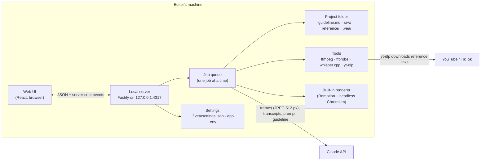
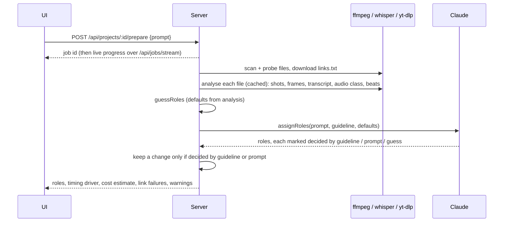
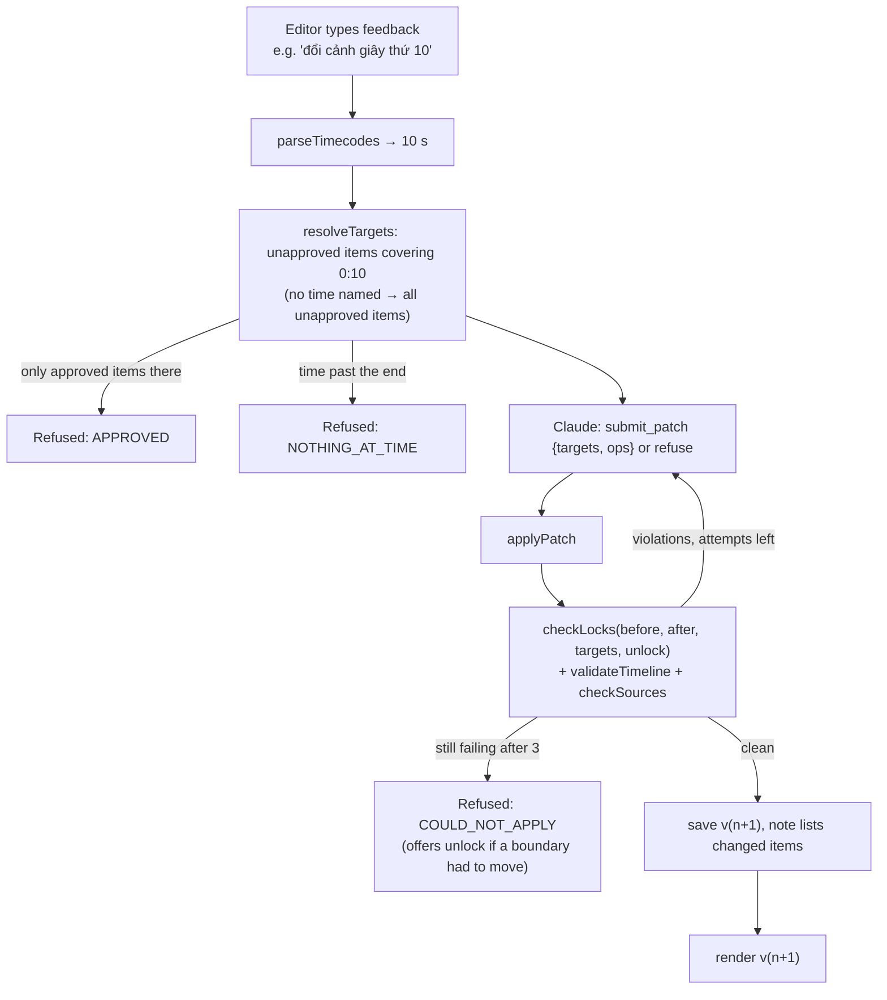

# Architecture and workflow

How the video edit agent is built and what happens, step by step, when an editor makes and fixes a video. For setup and day-to-day use see the [README](../README.md); for the reasoning behind the design see [the Phase 1 design](superpowers/specs/2026-11-16-video-edit-agent-design.md).

## 1. The big picture

The app runs on the editor's own machine. A browser page talks to a local server; the server reads the project folder, asks Claude to plan the edit, and renders the video locally. Only sampled frames, transcripts and text leave the machine.



Three ideas carry the whole design:

1. **The timeline is the single source of truth.** Every video is a JSON timeline (segments, captions, audio tracks, overlays, style). The agent writes timelines; engines read them; every version is kept on disk.
2. **The model proposes, the app decides.** Claude's output is never trusted directly: every timeline and every fix is validated by plain TypeScript before it is saved, and failures are fed back to the model (up to 3 attempts).
3. **Fixes are patches with locks.** Feedback becomes a small list of patch operations on named items. A lock check compares before and after and refuses any change to approved or untargeted items.

## 2. Code map

| Layer | Folder | What it does | Key entry points |
|---|---|---|---|
| Core | `src/core/` | The timeline format and the rules around it. Pure functions, no I/O except versions. | `validateTimeline` (timeline.ts), `applyPatch` / `checkLocks` / `setApproved` / `carryApprovals` (patch.ts), `VersionStore` (versions.ts), `parseTimecodes` (timecode.ts) |
| Project | `src/project/` | Reads a project folder. | `scanProject` (scan.ts), `probeMedia` (probe.ts), `downloadLinks` (links.ts), `loadGuideline` / `createFromStarter` (guideline.ts), `guessRoles` / `pickTimingDriver` (roles.ts), `resolveOnDisk` (paths.ts) |
| Analysis | `src/analysis/` | Turns media into something the model can read; cached per file. | `analyseProject` / `analyseFile` (index.ts): shots, one frame per shot, transcript, speech/music/silence, beats, cut rate |
| Agent | `src/agent/` | Everything that talks to Claude. | `assignRoles` (roles.ts), `planTimeline` (plan.ts), `fixTimeline` (fix.ts), `runToolLoop` / `checkSources` (loop.ts), prompts and frame budget (prompt.ts), `AnthropicModel` (model.ts), `estimateCost` (cost.ts) |
| Engines | `src/engines/` | Timeline in, video out. | `Engine` interface (types.ts), `getEngine` (registry.ts), `builtinEngine` (builtin/render.ts) with the Remotion composition in `builtin/remotion/` |
| Server | `src/server/` | HTTP API, jobs, settings, safety checks. | `buildApp` (app.ts), project routes (projectRoutes.ts), job bodies (pipeline.ts), `JobQueue` (jobs.ts), `SettingsStore` (settings.ts), `.env` handling (envfile.ts), `main.ts` |
| Web | `src/web/` | The editor's interface, Vietnamese and English. | pages: Projects, NewVideo, Result, Queue, Settings; `api.ts`; `useJobs.ts` (live job updates); `i18n/` |
| Starters | `starters/` | Six starter guidelines (real estate, vlog, trend × vi/en). | copied into a project as `guideline.md` |
| Scripts | `scripts/acceptance.ts` | Manual end-to-end run against the real Claude API. | `npx tsx scripts/acceptance.ts <projectDir> "<prompt>" ["<feedback>"]` |

Dependencies only point downward: web → server (over HTTP) → agent / engines / project / analysis → core. Core depends on nothing.

## 3. The data

### The timeline

All times are integer frames at 30 fps; source in/out points are seconds. Output is always 1080×1920.

```
Timeline
├─ segments[]   s1, s2 …  source (a file in raw/), sourceIn/sourceOut, startFrame, durationFrames,
│                         speed, crop, transitionIn, effects, clipGain, approved
├─ captions[]   c1, c2 …  text, startFrame/endFrame, words[] (word timings), animation line|word, approved
├─ audio[]      a1 …      narration | music, source, startFrame, sourceIn, gain
├─ overlays[]   o1 …      logo (an image in reference/) | title (text), start/end, position
└─ style                  font, primary/secondary colour, caption position and size
```

`validateTimeline` enforces: segments contiguous from frame 0 and summing to the total; unique ids; source ranges inside the real file; duration matching source range ÷ speed; first segment is a cut; captions inside the video. `checkSources` adds: segments only from `raw/`, audio only from the narration/music reference (or a style reference whose audio was explicitly allowed), logos only from images in `reference/`.

### Files on disk

```
<project>/
├─ guideline.md                 brand style + how to use each reference (written by the editor)
├─ raw/                         footage to edit
├─ reference/                   sample videos, audio, scripts, logo images, links.txt
└─ .vea/                        written by the app
   ├─ analysis/<hash>.json      analysis cache (key: path + size + mtime)
   ├─ analysis/frames/          sampled JPEG frames
   ├─ downloads/<sha1>.mp4      downloaded reference links
   ├─ prepare.json              roles from the last "Check references"
   └─ videos/<videoId>/
      ├─ video.json             prompt, engine, roles, notFollowed, which render each version shows
      ├─ v1.timeline.json  v1.meta.json  v1.mp4
      └─ v2.timeline.json  v2.meta.json  v2.mp4 …

~/.vea/settings.json            model, language, tool paths, prices, registered projects (mode 0600)
<app folder>/.env               AI_PROVIDER_KEY=… (mode 0600, git-ignored)
```

Versions are never overwritten: a new version number is claimed with an exclusive create, so even a bug cannot replace an earlier version.

## 4. Workflows

### 4.1 Set up

1. **Settings page.** The editor enters the AI key (saved to `.env` as `AI_PROVIDER_KEY`; `.env` beats the system environment) and the Whisper/yt-dlp paths (saved to `~/.vea/settings.json`). The page only ever receives the key's last 4 characters.
2. **Register a project.** The editor pastes a folder path. The server refuses the drive root, the home folder, the settings folder and any folder containing the app's `.env`, because `/media` serves files from project folders. It scans the folder and lists it.
3. **Optional starter guideline.** If the project has no `guideline.md`, the editor can create one from a starter and edit it.

### 4.2 Check references ("prepare" job)



Default roles: audio with speech → narration; audio without → music; any video reference → style (its audio unused); text → script; silence → ignore. The editor can change any role before generating; edits are recorded as decided by the editor.

The **timing driver** decides what the cut follows, in this order: narration audio → speech in the raw footage → the music's beat → the sample video's pace.

### 4.3 Generate

```mermaid
sequenceDiagram
  participant UI
  participant Server
  participant Claude
  participant Engine as Built-in renderer
  UI->>Server: POST /api/projects/:id/videos {prompt, roles, engine}
  Server->>Server: lock this video; analysis from cache
  Server->>Claude: system rules + guideline + prompt + frames + transcripts + beats
  loop up to 3 attempts
    Claude-->>Server: submit_timeline {timeline, notFollowed}
    Server->>Server: validateTimeline + checkSources
    Server-->>Claude: errors (if any) — try again
  end
  Server->>Server: save v1 (nothing approved), store notFollowed in video.json
  Server->>Engine: render v1
  Engine-->>Server: v1.mp4
  Server-->>UI: version 1, output URL, notFollowed
```

**Order of authority** — system rules > `guideline.md` > prompt > the agent's own guesses — is enforced in three places: the system prompt states it and puts the rules and guideline first; the validators enforce the system rules in code; and when the prompt conflicts with the guideline the model must list the ignored instruction in `notFollowed`, which the Result page shows.

**What Claude sees.** At most 100 images per request (at least one per raw file, style references capped at 12), each a 512 px JPEG of one shot, plus transcripts with word times, beat times and the guideline text. Full video and audio files never leave the machine.

### 4.4 Review, approve and fix



- **Approve** toggles one segment or caption. It saves a new version (same render, no re-render) so the approval is part of history.
- **Patch operations:** swap a segment's source clip, change effects, transition, crop, caption text or animation, a track's volume, or a segment's length (`retime`).
- **The lock check refuses:** any change to an approved item; any change to an item that is not a target; any added or removed item; any change to style, overlays or frame size; any move of narration or music; and, without unlock, any change to a segment boundary or the total length.
- **Unlock** ("allow later segments to move") lets a `retime` change a segment's length; later unapproved items may then only shift as a block, and captions inside a shortened segment are rescaled. Approved items still never change.
- **What the editor sees:** the reason for a refusal (translated), or the list of changed items with their times.

### 4.5 Go back, render again, start over

- **Go back to version n** saves version n's content as the newest version but keeps the *current* approvals. If any currently approved item differs in version n, the revert is refused (`APPROVED_CONFLICT`) and the editor is told which items to un-approve first.
- **Render again** appears when the newest version has no video (for example the first render failed because the renderer's browser could not be downloaded). It renders that version without creating a new one.
- **Start over** generates a new video from the same project, with its own history and no approvals.

## 5. Running jobs

- **One job at a time.** Prepare, generate, fix, revert and render jobs go through a serial queue. The UI follows progress over a server-sent-events stream.
- **One writer per video.** Every job or action that writes a video's versions holds that video's lock from "read the latest version" to "save". Approving while a job runs on the same video returns `BUSY`.
- **Errors are codes.** Jobs fail with `{ code, message }`; the UI translates the code (e.g. `NO_API_KEY`, `API_KEY_REJECTED`, `API_RATE_LIMIT`, `TRANSCRIBE_FAILED`, `FFMPEG_MISSING`, `UNSAFE_FOLDER`, `BROWSER_UNAVAILABLE`, `INVALID_AFTER_RETRIES`). A refused fix is not a failure: the job finishes with a refusal result.

## 6. Security and privacy

| Concern | How it is handled |
|---|---|
| Someone on the network | The server binds to 127.0.0.1 only. |
| A web page attacking the local server | Requests must carry a `localhost`/`127.0.0.1` Host and no foreign Origin (blocks DNS rebinding and cross-site requests). |
| Reading files outside a project | `/media` resolves real paths (symlinks included) and refuses anything outside the project folder, any `.env` file, and `.vea/` except renders and downloads. Responses carry a sandbox CSP and `nosniff`; SVGs are downloads. |
| The render's own file server | Per-render random port and random secret path prefix, same Host check, same `.vea` and `.env` rules. |
| The AI key | Stored only in `.env` (0600); the browser only sees the last 4 characters; a project folder may not contain `.env`; keys with line breaks are rejected. |
| Running external tools | Always an argument list (no shell), absolute file paths, and links only from YouTube/TikTok hosts, so a file name or URL cannot inject options. |
| What goes to Claude | Sampled frames, transcripts, the prompt, the guideline and script text. Downloaded reference audio is used in the video only when a role explicitly allows it. |

## 7. Extending

- **A new engine (e.g. CapCut drafts):** implement `Engine` in `src/engines/<id>/` — `capabilities()` (what transitions/effects/animations it supports; the agent reads this before planning), `availability()` (e.g. detect the installed CapCut version and whether drafts are readable), and `render()` returning `{ kind: 'capcutDraft', path }` — then register it in `src/engines/registry.ts` and remove the CapCut placeholder in `src/server/app.ts`.
- **A new patch operation:** add it to `PatchOp` and `applyPatch` in `src/core/patch.ts`, describe it in the fix tool schema in `src/agent/fix.ts`, and make sure `checkLocks` still sees every field it can change.
- **A new UI language:** add a dictionary next to `src/web/i18n/vi.ts`; the i18n test checks that every key exists in every language.

## 8. Testing

| Kind | Where | Notes |
|---|---|---|
| Unit | `tests/core`, `tests/project`, `tests/analysis`, `tests/agent`, `tests/server` | Real ffmpeg on tiny generated clips; Claude replaced by a scripted `FakeModel`; Whisper and yt-dlp replaced by fakes. |
| Rendering | `tests/engines` | Real Remotion renders; set `VEA_BROWSER` to a local Chromium where Remotion cannot download its own. |
| UI | `tests/web` | React Testing Library under jsdom, API mocked. |
| End to end | `tests/e2e/acceptance.test.ts` | Real server and renderer: generate → fix one segment (everything else identical) → approve → refused fix → revert. |
| Real AI | `scripts/acceptance.ts` | Manual, needs the AI key, Whisper and ffmpeg. |

Run everything with `npx vitest run` (about 90 s) and `npx tsc --noEmit`.

## 9. Known limits

- Built-in engine only; the CapCut engine is planned.
- No speed ramps; a fix re-renders the whole video; transcription is local only.
- Not yet run against the real Claude API, real Whisper or real yt-dlp, and only tested on Linux (the agency uses Windows and macOS).
- Remotion needs a paid company licence for organisations above three people; the first render on a machine downloads Remotion's browser.
- **Open issue:** with unlock, a `retime` makes the captions inside that segment implicit targets, and the lock check then accepts *any* change to those unapproved captions (including text), not only the rescale. Approved captions stay protected. Fix: accept an implicit caption change only if it equals the exact rescale (`rescaledCaptions` in `src/core/patch.ts`).
